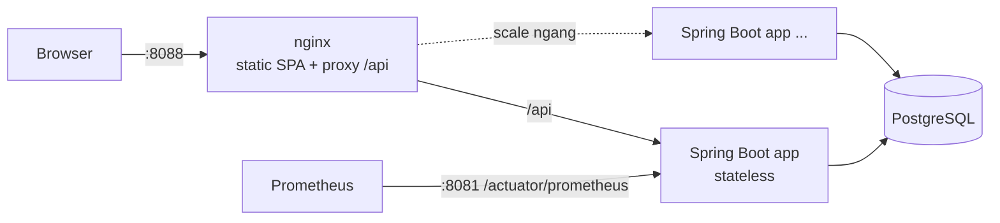
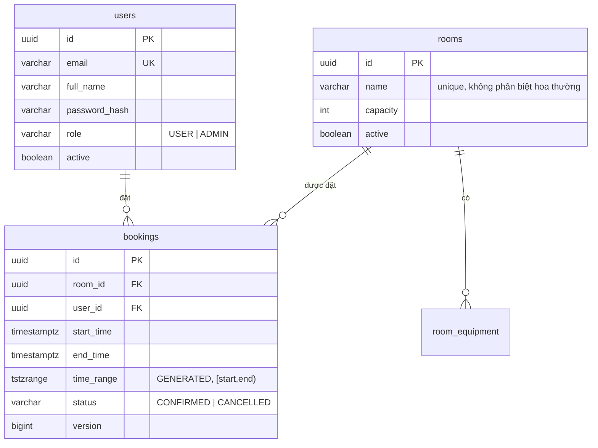
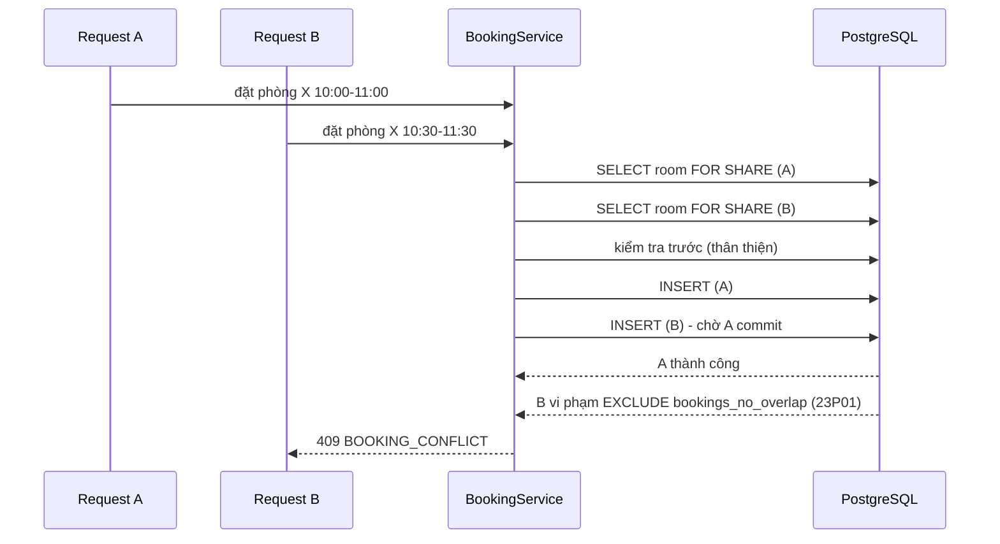

# Hệ thống đặt phòng họp (Meeting Room Booking)

Backend REST API + giao diện web cho công ty ~200 nhân viên / ~10 phòng họp. Mục tiêu chính: **không bao giờ trùng lịch**,
kể cả khi nhiều người đặt cùng lúc, và đủ chắc chắn để chạy thật (bảo mật, quan sát, test, scale ngang).

| Thành phần | Công nghệ |
|---|---|
| Backend | Java 21, Spring Boot 3.4, Spring Security (JWT), Spring Data JPA, Flyway |
| Database | PostgreSQL 16 (exclusion constraint chống trùng lịch) |
| Frontend | React 18 + TypeScript + Vite, TanStack Query, phục vụ bởi nginx (proxy `/api`); giao diện **tiếng Anh (mặc định) / tiếng Việt** |
| Chạy | Docker Compose (db + app + web) |
| Test | JUnit 5 + MockMvc trên PostgreSQL thật, test đồng thời (92 test) + e2e giao diện bằng Playwright (`e2e/`) |

## 1. Chạy nhanh

Yêu cầu: Docker (có Compose). Không cần cài Java/Node.

```bash
docker compose up --build
```

| Địa chỉ | Là gì |
|---|---|
| **http://localhost:8088** | Giao diện web (đi vào đây) |
| http://localhost:8080 | **API** (mở bằng trình duyệt sẽ chuyển tới Swagger UI; các endpoint cần token nên gọi trực tiếp sẽ trả 401) |

Tài khoản demo (profile `demo` bật sẵn trong compose, có 10 phòng + vài booking mẫu cho ngày mai):

| Vai trò | Email | Mật khẩu |
|---|---|---|
| Admin | `admin@company.local` | `Admin12345!` |
| Nhân viên | `alice@company.local` (và `bob`, `carol`, `dave`, `eve`) | `Password123!` |

> Cổng 8088 đang bận? Đổi bằng `WEB_PORT=9000 docker compose up --build`.

**Chạy thật (production):** `cp .env.example .env`, đặt `JWT_SECRET`, `DB_PASSWORD`, `ADMIN_*` thật, `APP_PROFILE=prod`
(không seed dữ liệu demo), `DEMO_HINT=false` (ẩn gợi ý tài khoản ở trang đăng nhập), rồi đặt sau TLS terminator/load balancer.

### Chạy test

```bash
./scripts/test.sh          # PostgreSQL tạm + toàn bộ test trong Docker, không cần Java local
```

Hoặc có Java 21 + Postgres: `TEST_DB_URL=jdbc:postgresql://localhost:5432/booking_test mvn test`.

Kiểm thử giao diện (cần stack đang chạy): xem [e2e/README.md](e2e/README.md).

> Máy ít RAM (Docker VM ~2GB): hãy `docker compose stop` stack trước khi chạy `./scripts/test.sh`, nếu không JVM của test có thể bị kernel kill (exit code 137).

### Phát triển local

```bash
docker run -d --name booking-db -p 5432:5432 -e POSTGRES_DB=booking -e POSTGRES_USER=booking \
  -e POSTGRES_PASSWORD=booking postgres:16-alpine   # chỉ database
JWT_SECRET=$(openssl rand -base64 48) mvn spring-boot:run
cd frontend && npm install && npm run dev     # http://localhost:5173, proxy /api -> :8080
```

## 2. Tính năng

**Nhân viên:** xem lịch tất cả phòng theo ngày (timeline, bấm vào ô trống để đặt) · tìm phòng trống theo ngày/giờ/số người/thiết bị ·
đặt, sửa (kể cả **đổi sang phòng khác**), hủy booking của mình · nhập **số người tham dự** (không vượt sức chứa) ·
**đặt lịch lặp** (hằng tuần, 2 tuần/lần, các ngày làm việc; trùng thì báo ngày nào và cho chọn bỏ qua) · hủy một buổi hoặc "buổi này và các buổi sau" ·
**thêm vào lịch (.ics)** · xem lịch sắp tới / đã qua / đã hủy · đổi mật khẩu ở trang Tài khoản.

**Quản trị:** thêm/sửa/vô hiệu hóa phòng · quản lý người dùng (tạo, đổi vai trò, khóa, đặt lại mật khẩu) ·
xem và hủy mọi booking, lọc theo phòng/người/loại/trạng thái/khoảng ngày · **chặn phòng theo khoảng thời gian** (bảo trì, vệ sinh, sự kiện),
nếu đang có booking trùng thì xem danh sách và chọn hủy chúng rồi chặn.

**Ngôn ngữ:** nút EN/VI ở thanh trên cùng (và ở trang đăng nhập). Mặc định luôn là tiếng Anh, lựa chọn được nhớ lại.
Bản dịch tiếng Việt bị ép đủ khóa lúc biên dịch (TypeScript), lỗi từ server được dịch theo `code` ổn định.

**Quy tắc đặt phòng** (cấu hình trong `application.yml`, UI đọc qua `GET /api/v1/config`, không hard-code):

| Quy tắc | Mặc định | Mã lỗi (HTTP 422) |
|---|---|---|
| Giờ làm việc, theo múi giờ công ty | 08:00–20:00, `Asia/Ho_Chi_Minh` | `OUTSIDE_WORKING_HOURS` |
| Bước thời gian | 15 phút, giây = 0 | `TIME_NOT_ALIGNED` |
| Thời lượng | 15 phút – 4 giờ | `DURATION_TOO_SHORT/LONG` |
| Không đặt quá khứ / tối đa 90 ngày tới | | `IN_THE_PAST`, `TOO_FAR_IN_ADVANCE` |
| Không xuyên ngày | | `CROSS_DAY_BOOKING` |
| Tối đa 50 booking tương lai/người (giới hạn mềm) | | `BOOKING_LIMIT_REACHED` |
| Phòng phải đang hoạt động | | `ROOM_INACTIVE` |
| Số người ≤ sức chứa phòng | bắt buộc nhập | `OVER_CAPACITY` |
| Lịch lặp: tối đa 26 buổi, mỗi buổi qua đủ các quy tắc trên | | `SERIES_CONFLICT`, `START_ON_WEEKEND` |

Trùng lịch → **409 `BOOKING_CONFLICT`**. Hai booking liền kề (10:00–11:00 và 11:00–12:00) **không** trùng.

## 3. Thiết kế

### Kiến trúc



Backend phân lớp theo tính năng: `controller (DTO + validation) → service (nghiệp vụ, transaction) → repository (JPA/Specification)`.
Package: `auth`, `user`, `room`, `booking`, `availability`, `security`, `common`, `bootstrap`.

### Mô hình dữ liệu



### Chống trùng lịch (phần quan trọng nhất)



`EXCLUDE USING gist (room_id WITH =, time_range WITH &&) WHERE (status = 'CONFIRMED')` là **nguồn chân lý duy nhất**.
Bước "kiểm tra trước" ở service chỉ để trả lỗi sớm; nếu hai request vượt qua nó cùng lúc thì DB vẫn chặn.
Được kiểm chứng bằng test: 20 luồng tranh 1 slot → đúng 1 thành công; 12 luồng với khung giờ gối nhau → không cặp nào chồng; đóng phòng đồng thời với đặt phòng → không có booking nào nằm trong phòng đã đóng.

### API (`/api/v1`) — chi tiết ở Swagger và [docs/requests.http](docs/requests.http)

| Method | Path | Quyền |
|---|---|---|
| POST | `/auth/login` · GET `/auth/me` · POST `/auth/change-password` | public / user |
| GET | `/config` | user |
| GET/POST/PUT/DELETE | `/rooms`, `/rooms/{id}`, POST `/rooms/{id}/activate` | đọc: user; ghi: admin |
| GET | `/rooms/available?start&end&minCapacity&equipment` | user |
| GET | `/rooms/{id}/schedule?date=` hoặc `?from=&to=` · `/rooms/{id}/free-slots?date=&minDuration=` · `/schedule?date=` | user |
| POST | `/bookings` · POST `/bookings/series` (lịch lặp) · PUT `/bookings/{id}` (có thể đổi `roomId`) · POST `/bookings/{id}/cancel` · POST `/bookings/{id}/cancel-series` · GET `/bookings/{id}` | chủ booking / admin |
| POST | `/admin/blocks` (chặn phòng; `cancelConflicting`) · gỡ chặn: `/bookings/{id}/cancel` · liệt kê: GET `/bookings?kind=BLOCK` | admin |
| GET | `/bookings/my` | user · `/bookings` (tất cả): admin |
| * | `/admin/users[...]` | admin |

Lỗi luôn là `application/problem+json`: `{ status, title, detail, code, requestId, errors[]? }`.
Danh sách có phân trang (`page`, `size` ≤ 100, `sort` theo whitelist).

Ví dụ:

```bash
TOKEN=$(curl -s localhost:8080/api/v1/auth/login -H 'Content-Type: application/json' \
  -d '{"email":"alice@company.local","password":"Password123!"}' | jq -r .accessToken)

curl -s "localhost:8080/api/v1/rooms/available?start=2030-01-15T10:00:00%2B07:00&end=2030-01-15T11:00:00%2B07:00" \
  -H "Authorization: Bearer $TOKEN" | jq '.content[].name'
```

## 4. Các quyết định quan trọng và lý do

| Quyết định | Lý do / đánh đổi |
|---|---|
| **Chặn trùng lịch bằng exclusion constraint của PostgreSQL**, không bằng lock ở ứng dụng | Đúng với mọi số instance và mọi đường ghi (kể cả script/SQL tay); không cần Redis lock. Đánh đổi: gắn với PostgreSQL (đề bài đã yêu cầu). |
| Khoảng nửa mở `[start, end)` | Họp liền kề không bị coi là trùng. |
| `timestamptz` lưu UTC; nghiệp vụ (giờ làm việc, "ngày") tính theo **múi giờ công ty** cấu hình | Không phụ thuộc múi giờ máy chủ/người dùng; API trả giờ kèm offset công ty. |
| Hủy mềm (`CANCELLED`) và vô hiệu hóa phòng thay vì xóa | Giữ lịch sử/báo cáo; ràng buộc FK không bị phá. Vô hiệu hóa bị chặn khi còn booking tương lai (`FOR UPDATE` trên phòng để không race với đặt phòng). |
| **Chặn phòng (block) là một dòng trong bảng `bookings`** (`kind = BLOCK`), không phải bảng riêng | Cùng exclusion constraint bảo vệ block và booking khỏi nhau, nguyên tử và an toàn đồng thời, không thêm đường code mới. Block khóa phòng `FOR UPDATE` và hủy booking trùng *trước khi* chèn. |
| Lịch lặp: tạo toàn bộ trong 1 transaction, mỗi buổi đều qua kiểm tra như booking đơn; `FAIL` (mặc định) hoặc `SKIP` | Không bao giờ để chuỗi tạo dở; người dùng biết chính xác ngày nào trùng. Chỉ hủy theo chuỗi, sửa từng buổi (đơn giản, dễ hiểu). |
| `.ics` tạo ngay trên trình duyệt | Không cần server/email; dùng được với Google, Outlook, Apple. |
| Khóa user → tự hủy booking tương lai của họ | Tránh "phòng ma" bị giữ bởi người đã nghỉ. |
| JWT stateless (HS256, TTL 60’), BCrypt | Scale ngang không cần session; kiểm tra `active` từ DB ở thao tác ghi quan trọng. Đánh đổi: xem mục Rủi ro. |
| Lỗi chuẩn RFC 7807 + `code` ổn định | Client xử lý theo `code`, không parse câu chữ. |
| Flyway + `ddl-auto=validate` | Schema có version, lệch schema là fail ngay khi khởi động. |
| Cấu hình validate lúc khởi động (`@Validated`) | Cấu hình sai thì dừng, không chạy với quy tắc sai. |
| Frontend là SPA phục vụ qua nginx, **cùng origin** với API | Không cần CORS; `docker compose up` là đủ. CSP + security headers đặt ở nginx. |
| Cổng quản trị (health/metrics) tách riêng **:8081**, không publish | Prometheus/healthcheck dùng được nhưng không lộ ra Internet. |
| Test chạy trên PostgreSQL thật, không H2 | Exclusion constraint/`tstzrange` chỉ có ở PostgreSQL; H2 sẽ cho kết quả xanh giả. |

## 5. Bảo mật

- Mật khẩu BCrypt; mật khẩu > 72 byte bị từ chối thay vì cắt ngầm. Đăng nhập: cùng thông báo cho sai email/mật khẩu/tài khoản khóa, so khớp giả để cân bằng thời gian, khóa tạm sau 5 lần sai (theo IP+email).
- Phân quyền: URL (`/admin/**`) + `@PreAuthorize`; USER chỉ thao tác booking của mình; lịch chung không lộ email.
- `X-Request-Id` được làm sạch (chống log injection); không trả stack trace; secret chỉ qua biến môi trường; container backend chạy bằng user không phải root.
- **Rủi ro đã biết:** token còn hiệu lực tới hết TTL sau khi đổi mật khẩu/hạ quyền; throttle đăng nhập theo từng instance; token ở `localStorage`. Chi tiết và hướng nâng cấp: [docs/04-review-log.md](docs/04-review-log.md).

## 6. Vận hành và khả năng mở rộng

- **Stateless**: chạy N bản app sau load balancer; trạng thái nằm ở PostgreSQL. Tổng `DB_POOL_SIZE × N` phải ≤ `max_connections` (hoặc dùng PgBouncer).
- **Truy vấn có index** phù hợp: `(room_id, start_time, end_time)` và `(start_time)` (partial `WHERE status='CONFIRMED'`), `(user_id, start_time)`; chỉ mục GiST của exclusion constraint cũng phục vụ kiểm tra chồng lấn. Mọi danh sách đều phân trang; tránh N+1 (`@BatchSize`, `@EntityGraph`).
- Quan sát: `/actuator/health/{liveness,readiness}`, `/actuator/prometheus` (cổng 8081), log có `requestId` + `userId`.
- Tắt êm (`graceful shutdown`), `restart: unless-stopped`, healthcheck có `depends_on: service_healthy`.
- Quy mô hiện tại (200 người, 10 phòng) là rất nhẹ. Nếu bảng `bookings` lên hàng chục triệu dòng: partition theo tháng + lưu trữ dữ liệu cũ; đọc nặng → read replica cho các endpoint lịch.
- Backup: `pg_dump`/WAL archiving của PostgreSQL (ngoài phạm vi compose).

## 7. Hạn chế và việc tiếp theo

Chưa làm (có chủ đích): thông báo email, đăng nhập SSO và mọi tích hợp dịch vụ ngoài (đã loại khỏi phạm vi), mời người tham dự / khách (xem phân tích:
phòng vật lý chỉ cần giữ chỗ; mời chỉ cần khi có họp online), check-in/tự giải phóng no-show, báo cáo sử dụng, audit log, sửa cả chuỗi lặp một lần,
refresh token / cookie `HttpOnly`, rate-limit tập trung. Admin hủy booking của người khác chỉ để lại lý do ở tab "Đã hủy" (chưa gửi thông báo).

## 8. Cấu trúc thư mục

```
src/main/java/com/company/booking/   backend (auth, user, room, booking, availability, security, common, bootstrap)
src/main/resources/db/migration/     Flyway
src/test/                            unit + integration + concurrency
frontend/                            React app + nginx.conf + Dockerfile
e2e/                                 Playwright: chạy giao diện thật trên stack đang chạy
docs/                                kế hoạch, checklist, nhật ký review, requests.http
docker-compose.yml                   db + app + web
docker-compose.test.yml, scripts/    chạy test trong Docker
```

Tài liệu quá trình: [kế hoạch](docs/01-plan.md) · [checklist yêu cầu](docs/02-checklist-requirements.md) ·
[checklist tính năng](docs/03-checklist-features.md) · [nhật ký review](docs/04-review-log.md).
