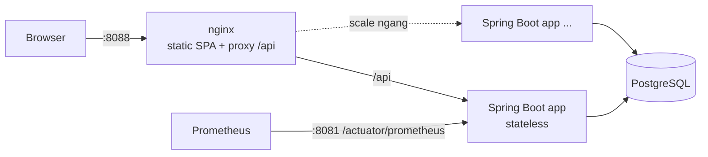
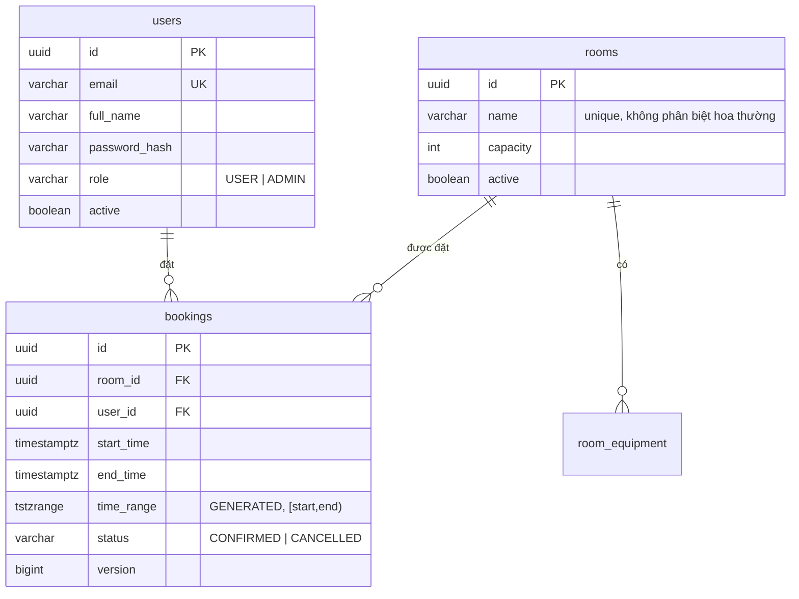
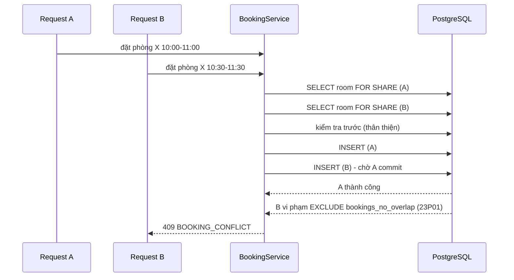

# Hệ thống đặt phòng họp (Meeting Room Booking)

Backend REST API + giao diện web cho công ty ~200 nhân viên / ~10 phòng họp. Mục tiêu chính: **không bao giờ trùng lịch**,
kể cả khi nhiều người đặt cùng lúc, và đủ chắc chắn để chạy thật (bảo mật, quan sát, test, scale ngang).

| Thành phần | Công nghệ |
|---|---|
| Backend | Java 21, Spring Boot 3.4, Spring Security (JWT), Spring Data JPA, Flyway |
| Database | PostgreSQL 16 (exclusion constraint chống trùng lịch) |
| Frontend | React 18 + TypeScript + Vite, TanStack Query, phục vụ bởi nginx (proxy `/api`); giao diện **tiếng Anh (mặc định) / tiếng Việt** |
| Chạy | Docker Compose (db + app + web) |
| Test | JUnit 5 + MockMvc trên PostgreSQL thật, test đồng thời (129 test) + e2e giao diện bằng Playwright (`e2e/`) |

## 1. Chạy nhanh

Yêu cầu: Docker (có Compose). Không cần cài Java/Node.

```bash
docker compose up --build
```

| Địa chỉ | Là gì |
|---|---|
| **http://localhost:8088** | Giao diện web (đi vào đây) |
| http://localhost:8080 | **API** (mở bằng trình duyệt sẽ chuyển tới Swagger UI; các endpoint cần token nên gọi trực tiếp sẽ trả 401) |

Tài khoản demo (profile `demo` bật sẵn trong compose, có 10 phòng + vài booking mẫu cho ngày mai):

| Vai trò | Email | Mật khẩu |
|---|---|---|
| Admin | `admin@company.local` | `Admin12345!` |
| Nhân viên | `alice@company.local` (và `bob`, `carol`, `dave`, `eve`) | `Password123!` |

> Cổng 8088 đang bận? Đổi bằng `WEB_PORT=9000 docker compose up --build`.

**Chạy thật (production):** `cp .env.example .env`, đặt `JWT_SECRET`, `DB_PASSWORD`, `ADMIN_*` thật, `APP_PROFILE=prod`
(không seed dữ liệu demo), `DEMO_HINT=false` (ẩn gợi ý tài khoản ở trang đăng nhập), rồi đặt sau TLS terminator/load balancer.

### Chạy test

```bash
./scripts/test.sh          # PostgreSQL tạm + toàn bộ test trong Docker, không cần Java local
```

Hoặc có Java 21 + Postgres: `TEST_DB_URL=jdbc:postgresql://localhost:5432/booking_test mvn test`.

Kiểm thử giao diện (cần stack đang chạy): xem [e2e/README.md](e2e/README.md).

> Máy ít RAM (Docker VM ~2GB): hãy `docker compose stop` stack trước khi chạy `./scripts/test.sh`, nếu không JVM của test có thể bị kernel kill (exit code 137).

### Phát triển local

```bash
docker run -d --name booking-db -p 5432:5432 -e POSTGRES_DB=booking -e POSTGRES_USER=booking \
  -e POSTGRES_PASSWORD=booking postgres:16-alpine   # chỉ database
JWT_SECRET=$(openssl rand -base64 48) mvn spring-boot:run
cd frontend && npm install && npm run dev     # http://localhost:5173, proxy /api -> :8080
```

## 2. Tính năng

**Nhân viên:** xem lịch tất cả phòng theo ngày (timeline, bấm vào ô trống để đặt) · tìm phòng trống theo ngày/giờ/số người/thiết bị ·
đặt, sửa (kể cả **đổi sang phòng khác**), hủy booking của mình · nhập **số người tham dự** (không vượt sức chứa) · đánh dấu **họp riêng tư** (người khác chỉ thấy phòng đang bận) ·
**đặt lịch lặp** (hằng tuần, 2 tuần/lần, các ngày làm việc; trùng thì báo ngày nào và cho chọn bỏ qua) · hủy một buổi hoặc "buổi này và các buổi sau" ·
**thêm vào lịch (.ics)** · xem lịch sắp tới / đã qua / đã hủy · đổi mật khẩu ở trang Tài khoản.

**Quản trị:** thêm/sửa/vô hiệu hóa phòng · quản lý người dùng (tạo, đổi vai trò, khóa, đặt lại mật khẩu) ·
xem và hủy mọi booking, lọc theo phòng/người/loại/trạng thái/khoảng ngày · **chặn phòng theo khoảng thời gian** (bảo trì, vệ sinh, sự kiện),
nếu đang có booking trùng thì xem danh sách và chọn hủy chúng rồi chặn.

**Ngôn ngữ:** nút EN/VI ở thanh trên cùng (và ở trang đăng nhập). Mặc định luôn là tiếng Anh, lựa chọn được nhớ lại.
Bản dịch tiếng Việt bị ép đủ khóa lúc biên dịch (TypeScript), lỗi từ server được dịch theo `code` ổn định.

**Quy tắc đặt phòng** (cấu hình trong `application.yml`, UI đọc qua `GET /api/v1/config`, không hard-code):

| Quy tắc | Mặc định | Mã lỗi (HTTP 422) |
|---|---|---|
| Giờ làm việc, theo múi giờ công ty | 08:00–20:00, `Asia/Ho_Chi_Minh` | `OUTSIDE_WORKING_HOURS` |
| Bước thời gian | 15 phút, giây = 0 | `TIME_NOT_ALIGNED` |
| Thời lượng | 15 phút – 4 giờ | `DURATION_TOO_SHORT/LONG` |
| Không đặt quá khứ (khung giờ hiện tại vẫn đặt được trong 15 phút đầu) | | `IN_THE_PAST` |
| Đặt trước tối đa **30 ngày** (lịch lặp và chặn phòng: **90 ngày**), tính theo ngày dương lịch | | `TOO_FAR_IN_ADVANCE` |
| Không xuyên ngày | | `CROSS_DAY_BOOKING` |
| Tối đa **20 lịch sắp tới/người** trong 30 ngày tới (**giới hạn cứng**, an toàn khi gửi song song) | | `BOOKING_LIMIT_REACHED` |
| Tối đa **8 giờ đặt/người/ngày** (cộng dồn mọi phòng) | | `DAILY_LIMIT_REACHED` |
| Tối đa 30 thao tác thay đổi booking/người/phút | | `RATE_LIMITED` (429) |
| Cuộc họp **đang diễn ra** chỉ đổi được giờ kết thúc (kéo dài, hoặc kết thúc sớm để trả phòng) | | `BOOKING_ALREADY_STARTED` |
| Phòng phải đang hoạt động | | `ROOM_INACTIVE` |
| Số người ≤ sức chứa phòng | bắt buộc nhập | `OVER_CAPACITY` |
| Lịch lặp: tối đa 26 buổi, mỗi buổi qua đủ các quy tắc trên | | `SERIES_CONFLICT`, `START_ON_WEEKEND` |

Trùng lịch → **409 `BOOKING_CONFLICT`**. Hai booking liền kề (10:00–11:00 và 11:00–12:00) **không** trùng.

## 3. Thiết kế

### Kiến trúc



Backend phân lớp theo tính năng: `controller (DTO + validation) → service (nghiệp vụ, transaction) → repository (JPA/Specification)`.
Package: `auth`, `user`, `room`, `booking`, `availability`, `security`, `common`, `bootstrap`.

### Mô hình dữ liệu



### Chống trùng lịch (phần quan trọng nhất)



`EXCLUDE USING gist (room_id WITH =, time_range WITH &&) WHERE (status = 'CONFIRMED')` là **nguồn chân lý duy nhất**.
Bước "kiểm tra trước" ở service chỉ để trả lỗi sớm; nếu hai request vượt qua nó cùng lúc thì DB vẫn chặn.
Được kiểm chứng bằng test: 20 luồng tranh 1 slot → đúng 1 thành công; 12 luồng với khung giờ gối nhau → không cặp nào chồng; đóng phòng đồng thời với đặt phòng → không có booking nào nằm trong phòng đã đóng.

### API (`/api/v1`) — chi tiết ở Swagger và [docs/requests.http](docs/requests.http)

| Method | Path | Quyền |
|---|---|---|
| POST | `/auth/login` · GET `/auth/me` · POST `/auth/change-password` (trả token mới, các phiên cũ bị thu hồi) | public / user |
| GET | `/config` | user |
| GET/POST/PUT/DELETE | `/rooms`, `/rooms/{id}`, POST `/rooms/{id}/activate` | đọc: user; ghi: admin |
| GET | `/rooms/available?start&end&minCapacity&equipment` | user |
| GET | `/rooms/{id}/schedule?date=` hoặc `?from=&to=` · `/rooms/{id}/free-slots?date=&minDuration=` · `/schedule?date=` | user |
| POST | `/bookings` · POST `/bookings/series` (lịch lặp) · PUT `/bookings/{id}` (có thể đổi `roomId`) · POST `/bookings/{id}/cancel` · POST `/bookings/{id}/cancel-series` · GET `/bookings/{id}` | chủ booking / admin |
| POST | `/admin/blocks` (chặn phòng; `cancelConflicting`) · gỡ chặn: `/bookings/{id}/cancel` · liệt kê: GET `/bookings?kind=BLOCK` | admin |
| GET | `/bookings/my` | user · `/bookings` (tất cả): admin |
| * | `/admin/users[...]` | admin |

Lỗi luôn là `application/problem+json`: `{ status, title, detail, code, requestId, errors[]? }`.
Danh sách có phân trang (`page`, `size` ≤ 100, `sort` theo whitelist).

Ví dụ:

```bash
TOKEN=$(curl -s localhost:8080/api/v1/auth/login -H 'Content-Type: application/json' \
  -d '{"email":"alice@company.local","password":"Password123!"}' | jq -r .accessToken)

curl -s "localhost:8080/api/v1/rooms/available?start=2030-01-15T10:00:00%2B07:00&end=2030-01-15T11:00:00%2B07:00" \
  -H "Authorization: Bearer $TOKEN" | jq '.content[].name'
```

## 4. Các quyết định quan trọng và lý do

| Quyết định | Lý do / đánh đổi |
|---|---|
| **Chặn trùng lịch bằng exclusion constraint của PostgreSQL**, không bằng lock ở ứng dụng | Đúng với mọi số instance và mọi đường ghi (kể cả script/SQL tay); không cần Redis lock. Đánh đổi: gắn với PostgreSQL (đề bài đã yêu cầu). |
| Khoảng nửa mở `[start, end)` | Họp liền kề không bị coi là trùng. |
| `timestamptz` lưu UTC; nghiệp vụ (giờ làm việc, "ngày") tính theo **múi giờ công ty** cấu hình | Không phụ thuộc múi giờ máy chủ/người dùng; API trả giờ kèm offset công ty. |
| Hủy mềm (`CANCELLED`) và vô hiệu hóa phòng thay vì xóa | Giữ lịch sử/báo cáo; ràng buộc FK không bị phá. Vô hiệu hóa bị chặn khi còn booking tương lai (`FOR UPDATE` trên phòng để không race với đặt phòng). |
| **Chặn phòng (block) là một dòng trong bảng `bookings`** (`kind = BLOCK`), không phải bảng riêng | Cùng exclusion constraint bảo vệ block và booking khỏi nhau, nguyên tử và an toàn đồng thời, không thêm đường code mới. Block khóa phòng `FOR UPDATE` và hủy booking trùng *trước khi* chèn. |
| Lịch lặp: tạo toàn bộ trong 1 transaction, mỗi buổi đều qua kiểm tra như booking đơn; `FAIL` (mặc định) hoặc `SKIP` | Không bao giờ để chuỗi tạo dở; người dùng biết chính xác ngày nào trùng. Chỉ hủy theo chuỗi, sửa từng buổi (đơn giản, dễ hiểu). |
| `.ics` tạo ngay trên trình duyệt | Không cần server/email; dùng được với Google, Outlook, Apple. |
| **Họp riêng tư: che dữ liệu ở server**, theo người xem, một chỗ duy nhất (`BookingMapper`); mặc định công khai | Che ở UI thì mở DevTools/gọi API vẫn đọc được. Người khác chỉ thấy phòng bận + khung giờ (bắt buộc để chống trùng): ẩn tiêu đề, mô tả, **tên người đặt**, số người, chuỗi lặp, lý do hủy. Chủ booking và **admin vẫn thấy đầy đủ** (admin cần hủy/quản lý; đây là quyết định tin cậy có chủ đích). Không xác định được người xem thì che. Có test kiểm tra không rò rỉ qua lịch ngày, lịch phòng, lỗi trùng lịch, tìm phòng, truy cập trực tiếp, lịch lặp. |
| Khóa user → tự hủy booking tương lai của họ | Tránh "phòng ma" bị giữ bởi người đã nghỉ. |
| JWT (HS256, TTL 8 giờ) **kèm phiên bản tài khoản**, BCrypt | Mỗi request đối chiếu token với tài khoản (cache 30 giây/instance, hủy cache ngay khi đổi). Đổi mật khẩu, hạ quyền, khóa tài khoản có hiệu lực **tức thì**; nhờ vậy TTL dài (cả ngày làm việc) không tạo cửa sổ rủi ro. Chi phí: 1 truy vấn theo khóa chính/người dùng/30 giây. |
| Hạn mức mỗi người là **cứng**: khóa dòng người dùng (`FOR UPDATE`) trước khi kiểm tra | Hai request song song của cùng một người không thể cùng lọt qua giới hạn (có test 10 luồng). Thứ tự khóa cố định người dùng → phòng nên không deadlock. |
| Hạn mức tính trên *lịch sắp tới trong 30 ngày* + *giờ/ngày* | Chặn đúng rủi ro thật (ôm phòng gần hạn: một người từng có thể giữ hơn nửa công suất vài ngày tới); các buổi xa của lịch lặp không chiếm hạn mức gần. |
| Không có luồng chờ duyệt | Làm mất lợi thế đặt ngay và biến admin thành nút cổ chai cho 200 người; hạn mức + giới hạn tốc độ + khóa tài khoản (tự hủy mọi lịch) giải quyết lạm dụng. |
| DB: `lock_timeout 5s`, `statement_timeout 15s`, `idle_in_transaction 30s` | Khóa/truy vấn treo không làm cạn kết nối; client nhận 503 `SERVICE_BUSY` + `Retry-After` thay vì treo. Flyway dùng kết nối riêng để migration không bị cắt. |
| Luôn còn ít nhất một admin (khóa advisory + đếm lại) | Hai admin hạ quyền nhau cùng lúc không thể để hệ thống không còn ai quản trị (có test). |
| Cấu hình production bị chặn nếu còn giá trị ví dụ | `APP_PROFILE=prod` sẽ **không khởi động** nếu `JWT_SECRET`/`ADMIN_PASSWORD`/`DB_PASSWORD` còn là giá trị mẫu, hoặc chạy chung với profile `demo`. |
| Lỗi chuẩn RFC 7807 + `code` ổn định | Client xử lý theo `code`, không parse câu chữ. |
| Flyway + `ddl-auto=validate` | Schema có version, lệch schema là fail ngay khi khởi động. |
| Cấu hình validate lúc khởi động (`@Validated`) | Cấu hình sai thì dừng, không chạy với quy tắc sai. |
| Frontend là SPA phục vụ qua nginx, **cùng origin** với API | Không cần CORS; `docker compose up` là đủ. CSP + security headers đặt ở nginx. |
| Cổng quản trị (health/metrics) tách riêng **:8081**, không publish | Prometheus/healthcheck dùng được nhưng không lộ ra Internet. |
| Test chạy trên PostgreSQL thật, không H2 | Exclusion constraint/`tstzrange` chỉ có ở PostgreSQL; H2 sẽ cho kết quả xanh giả. |

## 5. Bảo mật

- **Phiên đăng nhập thu hồi được:** token mang phiên bản tài khoản; đổi/đặt lại mật khẩu, đổi vai trò, khóa tài khoản làm các token cũ vô hiệu ngay. Role lấy từ DB, không tin claim trong token.
- Mật khẩu BCrypt; mật khẩu > 72 byte bị từ chối thay vì cắt ngầm. Đăng nhập: cùng thông báo cho sai email/mật khẩu/tài khoản khóa, so khớp giả để cân bằng thời gian, khóa tạm sau 5 lần sai (theo IP+email). Đổi mật khẩu cũng bị giới hạn số lần đoán mật khẩu hiện tại (chống dò bằng token bị đánh cắp).
- **Chống giả IP:** nginx *ghi đè* `X-Forwarded-For` bằng địa chỉ thật (không nối thêm), nên không né được khóa đăng nhập bằng header giả. Cổng API 8080 chỉ mở ở `127.0.0.1`: client bắt buộc đi qua nginx (đã kiểm chứng).
- **Chống lạm dụng:** hạn mức cứng (xem bảng quy tắc), 30 thay đổi/phút/người, nginx giới hạn 50 req/s/IP và 30 đăng nhập/phút/IP (rộng vì cả văn phòng có thể chung một IP), body tối đa 64 KB (nginx và app).
- Phân quyền: URL (`/admin/**`) + `@PreAuthorize`; USER chỉ thao tác booking của mình; lịch chung không lộ email.
- **Họp riêng tư** (ví dụ thương lượng lương): tick "Họp riêng tư" khi đặt; người khác không đọc được tiêu đề/mô tả/tên người đặt qua bất kỳ API nào. Giới hạn: không thể giấu việc "phòng đang bận"; admin xem được chi tiết.
- **Nhật ký kiểm toán:** logger `AUDIT` ghi ai làm gì (tạo/sửa/khóa người dùng, đặt lại mật khẩu, thay đổi phòng, chặn phòng, admin hủy booking của người khác, đăng nhập thất bại). Dữ liệu người dùng được làm sạch để không giả được dòng log.
- `X-Request-Id` được làm sạch; không trả stack trace; secret chỉ qua biến môi trường; container backend chạy bằng user không phải root; log container được xoay vòng (10 MB × 3) để không đầy đĩa.
- **Rủi ro đã biết:** giới hạn tốc độ và khóa đăng nhập nằm trong bộ nhớ từng instance (N instance → giới hạn thực tế N lần; đặt thêm giới hạn chung ở gateway nếu chạy nhiều replica); token ở `localStorage` (giảm thiểu bằng CSP chặt, không render HTML người dùng; hướng nâng cấp: cookie `HttpOnly` + CSRF). Chi tiết: [docs/04-review-log.md](docs/04-review-log.md).

## 6. Vận hành và khả năng mở rộng

- **Stateless**: chạy N bản app sau load balancer; trạng thái nằm ở PostgreSQL. Tổng `DB_POOL_SIZE × N` phải ≤ `max_connections` (hoặc dùng PgBouncer).
- **Truy vấn có index** phù hợp: `(room_id, start_time, end_time)` và `(start_time)` (partial `WHERE status='CONFIRMED'`), `(user_id, start_time)`; chỉ mục GiST của exclusion constraint cũng phục vụ kiểm tra chồng lấn. Mọi danh sách đều phân trang; tránh N+1 (`@BatchSize`, `@EntityGraph`).
- Quan sát: `/actuator/health/{liveness,readiness}`, `/actuator/prometheus` (cổng 8081, không publish); log có `requestId` + `userId`; số liệu nghiệp vụ `booking_created_total`, `booking_rejected_total{reason}`, `booking_cancelled_total`, `api_errors_total{code}` để đặt cảnh báo (đột biến `RATE_LIMITED`, `DAILY_LIMIT_REACHED`, `SERVICE_BUSY`...).
- Mất hết admin (hiếm: hệ thống đã chặn việc này) hoặc quên mật khẩu admin: đặt `ADMIN_EMAIL`/`ADMIN_PASSWORD` mới rồi khởi động lại, tài khoản chưa tồn tại sẽ được tạo.
- Nâng cấp không gián đoạn: migration chỉ **thêm** cột/bảng (tương thích ngược với bản cũ đang chạy); token cũ (chưa có phiên bản) vẫn hợp lệ cho tới khi tài khoản thay đổi.
- Tắt êm (`graceful shutdown`), `restart: unless-stopped`, healthcheck có `depends_on: service_healthy`.
- Quy mô hiện tại (200 người, 10 phòng) là rất nhẹ. Nếu bảng `bookings` lên hàng chục triệu dòng: partition theo tháng + lưu trữ dữ liệu cũ; đọc nặng → read replica cho các endpoint lịch.
- Backup: `pg_dump`/WAL archiving của PostgreSQL (ngoài phạm vi compose).

## 7. Hạn chế và việc tiếp theo

Chưa làm (có chủ đích): thông báo email (thay bằng thông báo ngay trong ứng dụng khi admin hủy lịch của bạn), đăng nhập SSO và mọi tích hợp dịch vụ ngoài (đã loại khỏi phạm vi),
mời người tham dự / khách (phòng vật lý chỉ cần giữ chỗ; mời chỉ cần khi có họp online), check-in/tự giải phóng no-show, báo cáo sử dụng, sửa cả chuỗi lặp một lần
(sửa từng buổi, hủy theo chuỗi), refresh token / cookie `HttpOnly`, giới hạn tốc độ dùng chung giữa các replica.

## 8. Cấu trúc thư mục

```
src/main/java/com/company/booking/   backend (auth, user, room, booking, availability, security, common, bootstrap)
src/main/resources/db/migration/     Flyway
src/test/                            unit + integration + concurrency
frontend/                            React app + nginx.conf + Dockerfile
e2e/                                 Playwright: chạy giao diện thật trên stack đang chạy
docs/                                kế hoạch, checklist, nhật ký review, requests.http
docker-compose.yml                   db + app + web
docker-compose.test.yml, scripts/    chạy test trong Docker
```

Tài liệu quá trình: [kế hoạch](docs/01-plan.md) · [checklist yêu cầu](docs/02-checklist-requirements.md) ·
[checklist tính năng](docs/03-checklist-features.md) · [nhật ký review](docs/04-review-log.md).
